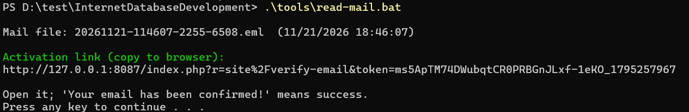

# 部署文档
本指南面向使用者，从零开始，在本机完成部署并验证系统可用。
## 1. 准备环境
| 工具 | 要求 |
|---|---|
| Windows | — |
| XAMPP | 自带 PHP 8.2（需 8.2.12 及以上）与 MySQL；安装后在 XAMPP 面板**启动 MySQL 服务** |
| Git | 用于克隆仓库 |
| Composer 2 | [getcomposer.org](https://getcomposer.org) 下载安装即可 |
## 2. 一键部署
```powershell
git clone https://github.com/wangyeG2/InternetDatabaseDevelopment.git
cd InternetDatabaseDevelopment
.\tools\deploy-xampp.bat
```
脚本执行过程中的**唯一交互**步骤为：提示 MySQL 用户名时输入 `root`。其余全部由一键部署脚本自动完成：生成网站入口与本地配置 → 安装依赖 → 创建 `worldcup` 数据库 → 建表导入数据。

### 部署成功的判据
脚本输出中应能看到以下内容，看到 `Deployment initialization completed.` 即部署完成：
- `Nothing to install or update`
- `9 migrations were applied.`
- `Migrated up successfully.`
- `Deployment initialization completed.`
## 3. 启动网站（两个终端窗口）
在 `advanced` 目录下分别打开两个powershell执行：
```powershell
# 窗口 1：前台
php -S 127.0.0.1:8087 -t frontend\web frontend\web\router.php
```
```powershell
# 窗口 2：后台
php -S 127.0.0.1:8088 -t backend\web backend\web\router.php
```
- 前台：<http://127.0.0.1:8087/>
- 后台：<http://127.0.0.1:8088/>
## 4. 初始化管理员账号
**第 1 步：注册**
浏览器打开前台注册页 `http://127.0.0.1:8087/index.php?r=site%2Fsignup`，注册一个账号（如 user1）。
**第 2 步：激活**
系统验证邮件不会真的发出，而是保存在文件 `advanced/frontend/runtime/mail/` 目录下。用记事本打开最新的一封邮件，里面的链接经过了编码，直接复制打开会 404。

在仓库根目录执行：
```powershell
.\tools\read-mail.bat
```
这是一个自动解析编码的脚本，把上述程序输出的 URL 完整复制到浏览器打开，看到 `Your email has been confirmed!` 且右上角显示已登录，即激活成功。理论上执行后用户应该会看到以下图片内容：

**第 3 步：授予管理员**
```powershell
cd advanced
php yii access/grant-admin user1     # user1 换成你注册的用户名
```
**第 4 步：登录后台**
浏览器打开 <http://127.0.0.1:8088/>，用**同一账号**登录。
## 5. 验证部署成功
逐项检查，全部通过即部署成功：
| # | 检查项 | 通过标准 |
|---|---|---|
| 1 | 部署脚本输出 | 出现 `Migrated up successfully.` 和 `Deployment initialization completed.` |
| 2 | 前台首页 | <http://127.0.0.1:8087/> 打开，有样式、有图标 |
| 3 | 注册 → 激活 | 邮件链接打开后显示 confirmed 且自动登录 |
| 4 | 后台登录 | 同一账号可在 <http://127.0.0.1:8088/> 登录进入管理界面 |
| 5 | 前后联动 | 后台发布一条新闻，刷新前台可见 |
## 6. 常见问题
- 脚本提示 PHP 版本不兼容：在命令行执行 `php -v`，确认是 XAMPP 的 PHP 且版本 ≥ 8.2.12；必要时把 `C:\xampp\php` 加入 PATH。
- 脚本提示数据库连接失败：确认 XAMPP 面板中 MySQL 已启动；用户名/密码与提示时输入的一致（XAMPP 默认 root、空密码）。
- 页面无样式、css/图片 404 或 500：启动网站时必须使用第 3 节的完整命令。
- 激活邮件链接打开 404：链接被编码了，用第 4 节第 2 步的命令提取可用 URL，不要手工复制邮件原文，也可以借助其他工具提取正确的URL。
- 后台登录不了：确认账号已在激活邮件链接处完成激活，并已执行 `grant-admin`；前后台需各自登录一次。
