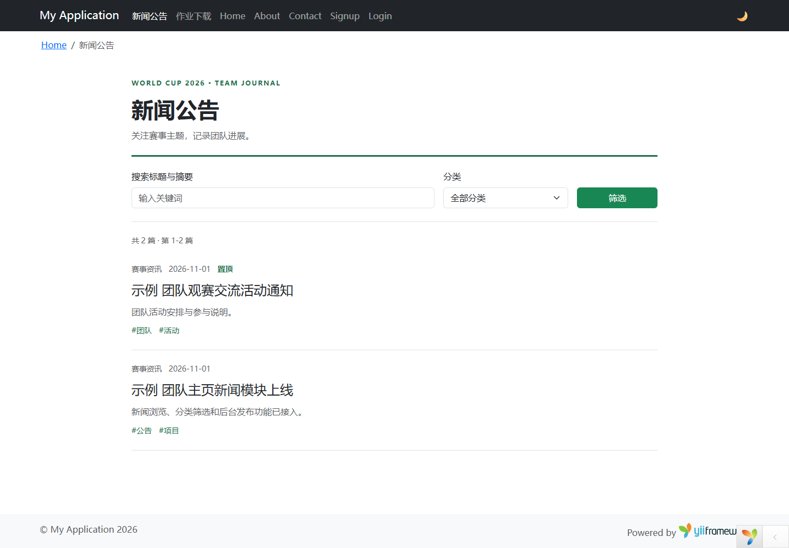
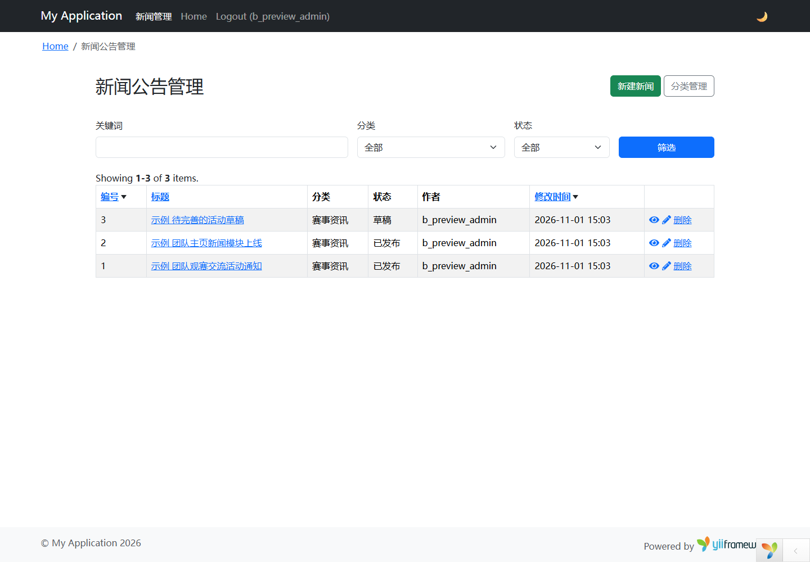
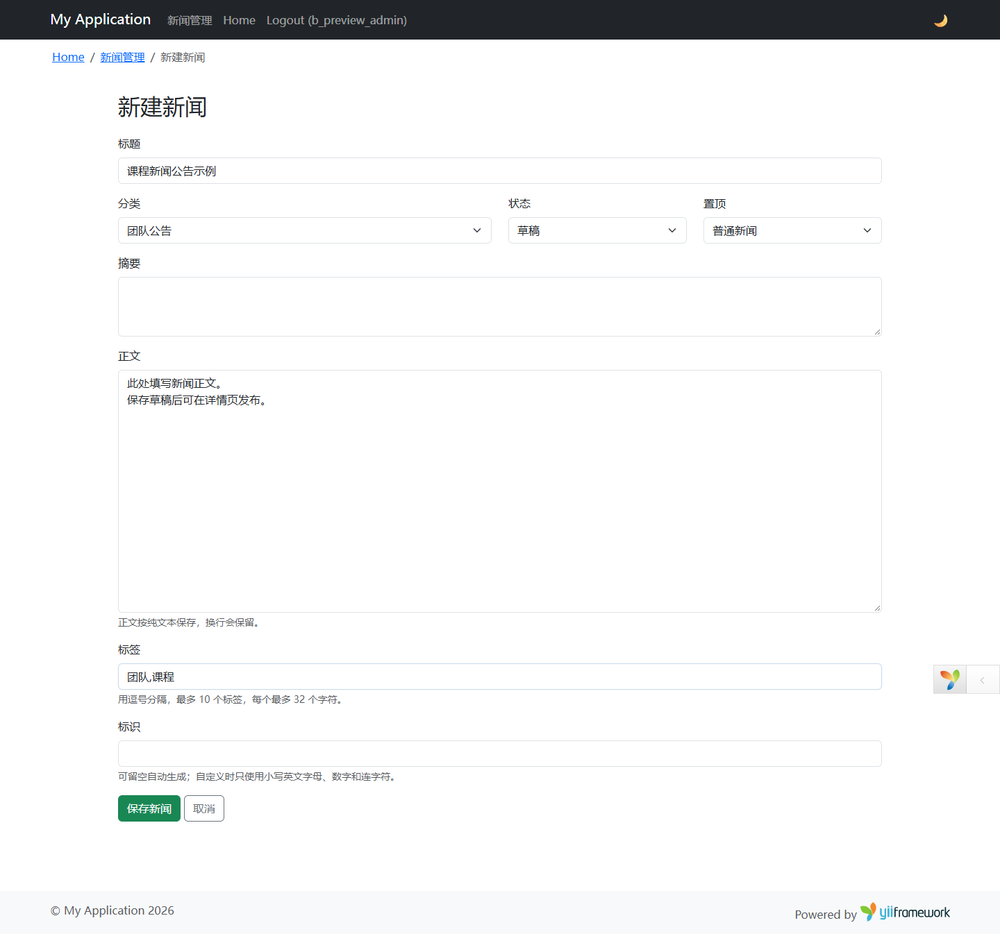
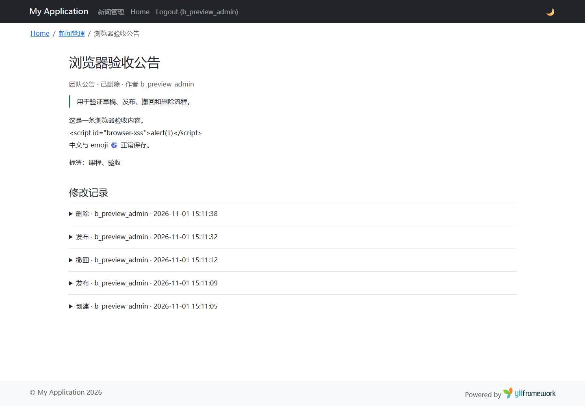

# 新闻公告模块实现文档（B）

版本：2026 年 11 月 1 日，B 模块独立验收版。

本模块在组长提供的 Yii2 Advanced 框架上实现新闻公告的公开浏览和后台管理。B 负责相关模型、控制器、页面、路由约定及集成测试，同时补充基础评审中影响后续管理功能的问题。本文可作为团队实现文档中 B 部分的合并稿；项目整体进度和其他成员的完成情况由组长汇总。

## 分工与实施范围

| 类别 | B 的实现内容 |
| --- | --- |
| Model | 新闻、分类、标签、标签关联、修改记录、查询和表单模型 |
| Controller | 前台新闻浏览，后台新闻和分类管理，作业下载入口 |
| View | 新闻列表、详情、后台列表、编辑、修改记录和分类页面 |
| 工程 | 管理员访问边界、请求类型校验、路由表、测试用例和源码打包工具 |
| 文档 | 本实现文档、接口约定、模块图与流程图、看板任务清单 |

组长负责的整体数据库设计、用户管理和部署仍由 A 集成。团队展示、共享布局、留言板及动态图形沿用其他成员的职责划分。

## 基础修复

原后台仅检查是否登录，普通注册用户也能进入后台。修复增加显式 `member/admin` 身份、后台统一检查、独立后台登录验证和命令行授权入口。新增用户默认普通身份，已有用户不自动升级。

原表单直接将请求值赋给字符串和布尔属性，数组输入可能在验证前抛出类型错误。共享 RequestForm 先检查输入形状，再交给原有验证逻辑；非法输入作为表单校验错误返回。

原项目声明支持 PHP 8.2，而锁定的 PHPUnit 要求至少 8.3。本次同步调整项目版本要求与锁文件，并通过 Composer 严格校验；实际验证使用 PHP 8.4.27。

Windows 检出会受自动换行转换影响。本次以 `.gitattributes` 固定 PHP 文件使用 LF，并对 B 修改的源文件补齐文件注释头和视图变量说明，执行仓库原有 Yii 编码规范检查。

## 业务流程

前台列表仅展示已发布且可公开的新闻，支持标题与摘要关键词、分类和标签筛选，并提供分页和置顶顺序。详情路由重复检查公开条件，防止直接使用编号读取草稿、删除记录或停用分类下的新闻。

管理员可保存草稿、编辑并发布、撤回和软删除。新闻正文按纯文本显示，保留换行并转义 HTML。新闻保存、标签关联更新和修改记录写入在同一事务内完成，保留原作者并单独记录本次修改人。

分类可以新增、修改及停用；停用后关联新闻从前台隐藏，后台仍可维护。删除新闻保留数据库记录和历史，避免破坏过程追踪。

新闻正文上限为 50000 字符。中文等多字节文本可能超过 MySQL `TEXT` 的容量，因此增加独立升级迁移，将正文和历史快照扩为 `MEDIUMTEXT`，并验证 50000 字符的中文正文及其历史快照均能完整保存。已有长内容时，反向缩小字段的迁移会拒绝执行，避免截断数据。

作业下载页面同时提供团队和个人两个分区，只列出固定目录中的 ZIP，以哈希标识查找文件。源码打包工具从 Git 的非忽略文件清单生成团队源码包，保留公开环境模板，排除实际本地配置、依赖目录、运行缓存和已有作业包。

## 主要目录

```text
advanced/common/models/          新闻模型 查询模型 请求表单 下载清单
advanced/backend/models/         新闻和分类编辑表单 后台登录表单
advanced/backend/services/       NewsService 事务业务
advanced/backend/components/     AdminAccess 统一后台权限
advanced/frontend/controllers/   NewsController DownloadController
advanced/backend/controllers/    NewsController NewsCategoryController
advanced/frontend/views/news/    前台列表和详情
advanced/backend/views/news/     后台编辑和历史
advanced/backend/views/news-category/  分类管理
advanced/console/migrations/     管理身份和新闻表迁移
advanced/console/controllers/    首次授权和示例新闻命令
docs/B/                          B 文档和后续证据
data/team/                       团队作业源码包目录
data/personal/                   个人作业下载目录
tools/package_b.py               源码打包工具
```

## 验证记录

使用 PHP 8.4.27、Yii 2.0.55、MySQL 8.0.45 完成验证。仓库原有用例与 B 新增用例共 69 项、237 条断言，全部通过；PHPStan 按仓库原有 level 5 配置检查通过，Yii 编码规范检查通过。具体命令、用例和适用范围见[集成测试报告](集成测试报告.md)。

安装 SQL 已在另一个空库中还原，包含六张业务表、三条默认分类和迁移版本记录，账号和新闻内容均为空。还原后再次运行迁移得到“无新迁移”，确认不会重复建表。示例新闻命令连续执行两次，记录数量保持不变。

在真实 Chromium 浏览器中完成新建草稿、发布、撤回、再次发布、软删除，以及前台公开状态检查；同时验证 GET 变更返回 405、缺少 CSRF 的 POST 返回 400、正文 HTML 转义和普通成员后台登录拒绝。390 像素宽度下，公开页面及后台编辑页面无横向溢出，后台表格在自身容器内左右滚动。

源码 ZIP 已检查文件完整性，并通过网页实际下载比对 SHA256；下载入口的 GET 和 HEAD 均正常。最新文件校验值保存在 `data/team/B_news_source.zip.sha256`。

## 主要代码

前台列表与详情共用公开查询，避免详情通过编号绕过发布条件：

```php
return $this->joinWith(['category c'], false)
    ->andWhere(['n.status' => News::STATUS_PUBLISHED, 'n.deleted_at' => null, 'c.is_active' => 1])
    ->andWhere(['<=', 'n.published_at', time()]);
```

后台服务在新闻保存后同步标签并记录本次操作，均使用同一个事务：

```php
$this->synchronizeTags($news, $form->tagNames());
$this->recordRevision($news, $editor, $created ? 'create' : 'update');
$transaction->commit();
```

异常路径回滚事务。测试通过模拟历史记录写入失败，确认新闻标题、标签和标签关联均恢复原状。完整实现见 `advanced/backend/services/NewsService.php`。

## 页面和协作证据

以下图片均为本地实际页面截图。示例内容已明确标注，开发环境保留原框架导航和调试工具条。









手机尺寸截图见 `evidence/03-news-list-mobile.png`、`evidence/04-news-detail-mobile.png`、`evidence/08-news-editor-mobile.png` 和 `evidence/09-news-admin-mobile.png`。

任务卡见 [Tower 看板任务清单](Tower看板任务清单.md)。用户确认尚无 Tower 账号，本次保留可直接录入的清单，未建立线上看板，也未生成 Tower 截图。Git 提交记录见 [gitlog.txt](gitlog.txt)，记录来自本地实际历史；当前没有远程推送或 PR 合并记录。

## 与课程验收的关系

B 已有 Model View Controller 三层文件和五张新闻业务表。连同框架用户表，当前只有六张业务表；迁移记录表属于框架维护用途，不作为业务表凑数。至少十一张表的整体验收须待全组业务集成后确认。

个人作业目录尚无真实 ZIP，页面显示“作业文件尚未上传”。其他成员需要放入各自作业包，团队源码包也需在全组集成后重新生成。真实 SMTP 投递、其他成员模块和全站最终部署均不属于本次已验证结论。
