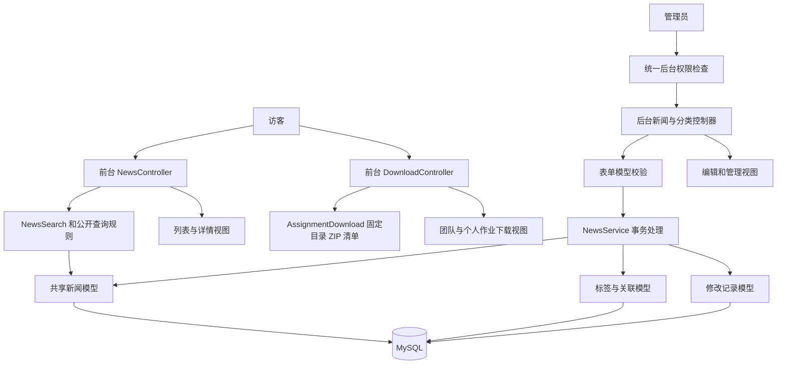
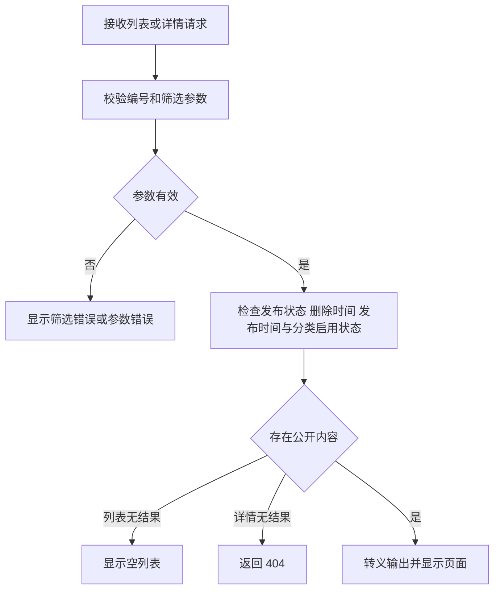
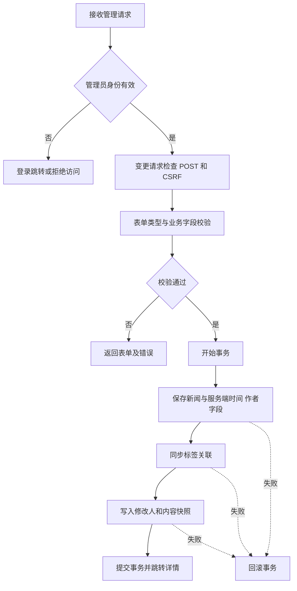
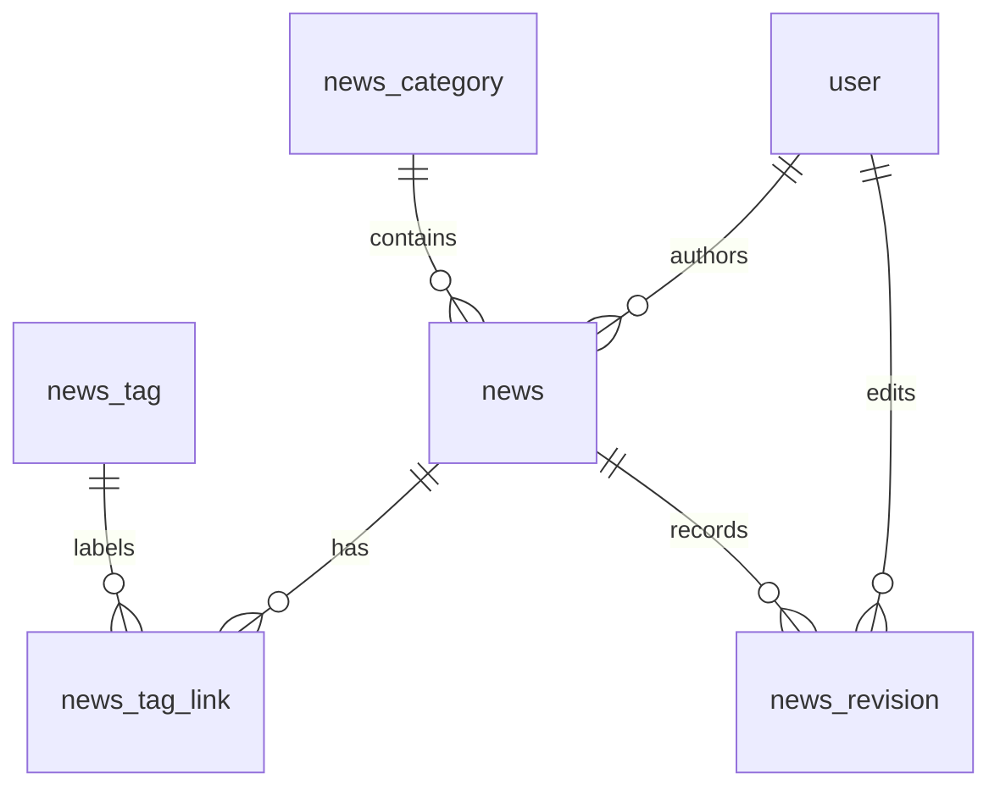
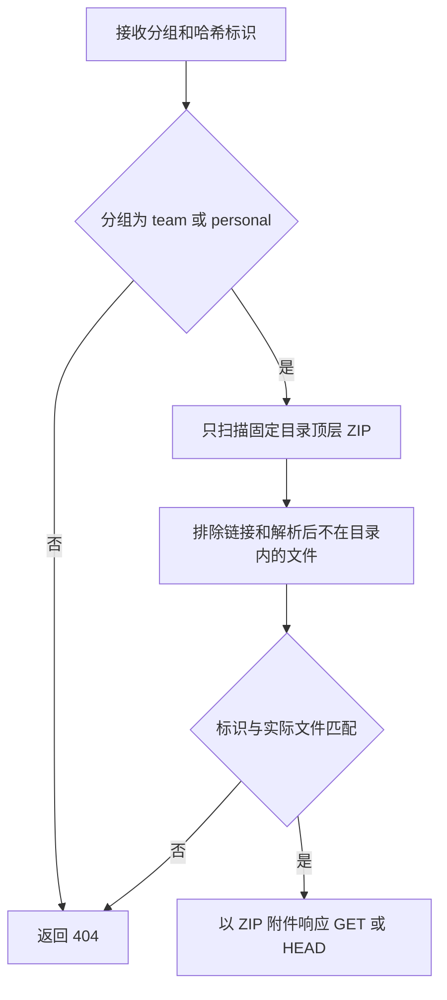

# 新闻公告模块设计图与流程图

本节供团队设计文档合并，说明 B 模块的分层、业务处理及数据关联。接口字段详见《接口与路由约定.md》。图采用 Mermaid 保存，可在支持 Mermaid 的 Markdown 阅读器中查看和继续编辑。

## 模块结构

## 公开浏览流程

## 编辑与发布流程

## 数据关联

`news_tag_link` 采用新闻编号和标签编号的联合主键。新闻和标签关联支持级联清理；新闻使用软删除，因此正常删除操作保留关联和历史。作者和修改人与用户表的外键限制直接物理删除，防止历史失去归属。

字段及索引详见[数据字典](设计文档_数据字典_B.md)。正文与快照采用 `MEDIUMTEXT`，以容纳表单允许的多字节长正文。

## 作业下载流程

